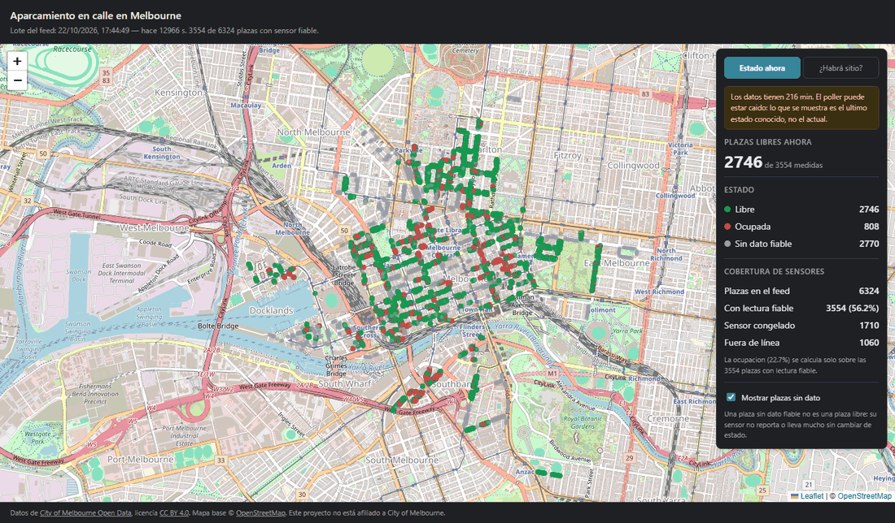
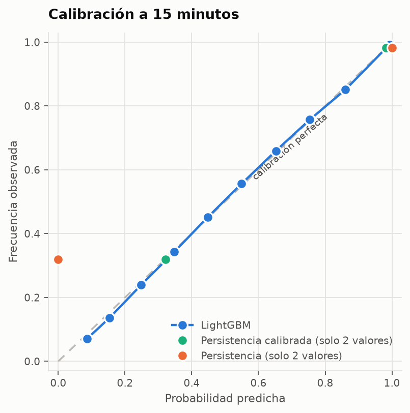
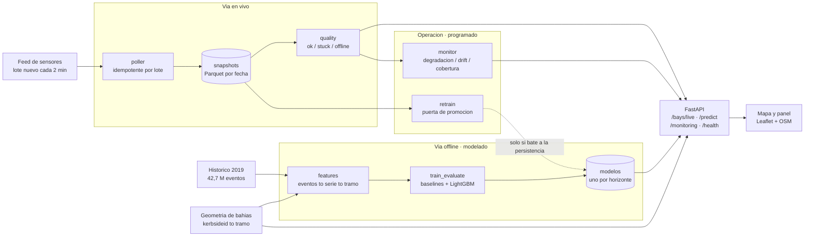
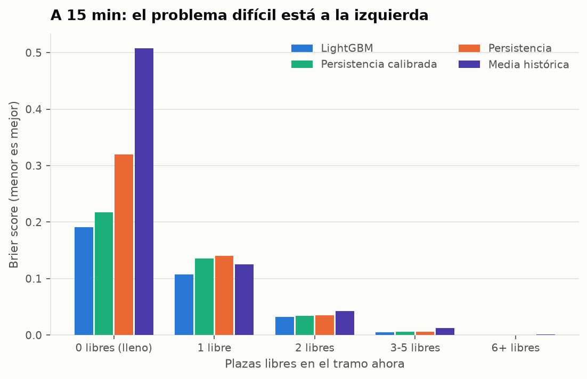

# parking-predict

Ocupación de aparcamiento en calle en Melbourne en tiempo real, y predicción de
la probabilidad de encontrar plaza en una zona **en el momento de llegada**.



<sub>Captura real. El aviso de datos antiguos salio porque el feed de origen
llevaba 3,6 h sin publicar un lote nuevo —el escenario de *Outages* que la
propia fuente advierte—. Se deja tal cual: es la deteccion de obsolescencia
haciendo su trabajo.</sub>

> Proyecto de portfolio. Las ocho fases del [PLAN.md](PLAN.md) están
> completadas. Los resultados de modelado son sobre datos históricos de 2019;
> ver [Qué no demuestra esto](#qué-no-demuestra-esto).

## ¿Por qué predecir, si ya hay datos en tiempo real?

Es la pregunta que justifica el proyecto, y merece una respuesta medida en vez
de una afirmación.

Cuando conduces 12 minutos hasta el destino, lo que te importa no es cómo está
la calle **ahora** sino cómo estará **al llegar**. La referencia obvia —y
durísima— es responder con el estado actual: la **persistencia**. Todo el
trabajo consiste en comprobar si se puede mejorar eso.

La respuesta corta: **sí, y el margen crece con el horizonte**.

| Horizonte | Mejora del modelo sobre la persistencia calibrada |
|---|---|
| 5 min | 12,8 % |
| 15 min | 14,9 % |
| **30 min** | **15,0 %** |

A 5 minutos la persistencia casi basta. A 30 —el caso de uso real, el conductor
que ya va de camino— la predicción sí cambia la respuesta.

Pero el argumento más fuerte no es el Brier score, es la **calibración**. La
persistencia cruda responde *"0 % de probabilidad"* en situaciones donde el
**32 %** de las veces sí hay sitio. Un producto construido sobre ella mandaría a
la gente a buscar más lejos de lo necesario una de cada tres veces.



## Arquitectura



Tres propiedades del diseño que vienen de hallazgos, no de preferencias:

- **El poller es idempotente por lote del feed, no por reloj.** El feed publica
  cada 2 minutos y reescribe el dataset entero; nombrar cada snapshot por
  `max(lastupdated)` hace que un reintento o un reinicio reescriban la misma
  celda en vez de duplicar.
- **La API no consulta la fuente**, lee lo que el poller guardó. Una caída de la
  API no interrumpe la captura, y una caída del feed no tumba la API — que
  sigue sirviendo el último estado conocido **diciendo lo viejo que es**.
- **El reentrenamiento tiene una puerta.** Un modelo nuevo no llega a producción
  si no bate a la persistencia.

## Los cuatro hallazgos que condicionaron todo

### 1. `Present` significa plaza **ocupada**

El campo describe el coche, no la plaza. Invertirlo no rompe nada: invierte el
objetivo del modelo en silencio.

### 2. Solo 3557 de las 6324 plazas dan una lectura utilizable

El feed falla de dos maneras distintas, y la segunda no se ve si solo se sigue
el consejo de la fuente (vigilar `lastupdated`):

| Estado | Plazas | Qué pasa |
|---|---|---|
| `ok` | **3557** (56,2 %) | reporta y cambia de estado |
| `stuck` | **1707** (27,0 %) | reporta, pero el sensor lleva una **mediana de 150 días** congelado |
| `offline` | 1060 (16,8 %) | ausente del lote actual del feed |

**El fallo más numeroso es el invisible.** Y los fallos son por relé, no por
sensor: 81 de 368 zonas fallan **en bloque**. Por eso "sin dato" es un estado de
primera clase en el mapa, no un hueco.

### 3. El histórico no cruza con el tiempo real a nivel de plaza

Recorrí los 238 datasets del catálogo: ningún dataset contiene a la vez
`kerbsideid` y `bayid`/`deviceid`, y el histórico no trae coordenadas. El cruce
aparente del 7,4 % es coincidencia aritmética — un join real da 95,5 %.

Lo que **sí** funciona es el **tramo de calle**, cruzando por nombre de calle y
las dos delimitadoras: cubre el **88 % de los eventos**. De ahí que la unidad
espacial del proyecto sea el tramo y no una celda H3.

### 4. El modelo es, en esencia, "una persistencia mejor medida"

El resultado menos lucido y el más honesto. El **90 % de la ganancia** sale de
dos features: el estado actual (44,2 %) y su media de los últimos 15 min
(46,1 %).

Las **zonas vecinas aportan un 0,6 %** y el **calendario un 1,6 %**, cuando el
plan las proponía como features relevantes. El ciclo diario es fortísimo, pero
el modelo no lo necesita: ya está implícito en el estado actual, que *es* el
resultado del ciclo.

## Dónde el modelo **no** mejora

La media global está dominada por los tramos vacíos, donde acierta cualquiera.
Desglosado por lo llena que está la zona (horizonte de 15 min):

| Plazas libres ahora | n | Tasa base | Mejora sobre la mejor persistencia |
|---|---|---|---|
| **0 (lleno)** | 276 608 | **31,9 %** | 12,1 % |
| 1 | 446 600 | 86,0 % | **20,7 %** |
| 2 | 520 227 | 96,5 % | 5,9 % |
| 3-5 | 1 278 852 | 99,5 % | 4,5 % |
| 6+ | 2 492 945 | 100,0 % | **irrelevante** |

- **En "6+ libres" el skill parece del 69 % y no significa nada**: la tasa base
  es del 99,99 % y el Brier absoluto 0,0001. Es la clase de cifra que luce en
  una tabla y es ruido.
- **A 5 minutos la persistencia calibrada ya hace el 87 % del trabajo.** Un
  producto que solo mostrara el estado actual bien expresado como probabilidad
  sería casi tan bueno a ese horizonte.
- **La media histórica —pura rutina— es el peor modelo de los cuatro** (Brier
  0,047 frente a 0,025), y a 30 minutos sigue siendo peor que la persistencia
  cruda. Saber que "los martes a las 11 esta calle suele tener sitio" es inútil
  cuando la calle está llena ahora mismo.



## Qué no demuestra esto

1. **Los resultados de modelado son sobre 2019.** El histórico publicado acaba
   en mayo de 2020 y el parque de sensores se renovó (cambió la numeración de
   `DeviceId` a `kerbsideid`). Entrenar producción con esos datos no es
   defendible.
2. **El modelo que sirve `/predict` está entrenado con 2019 y aplicado a datos
   de hoy.** Es una **demostración del flujo completo**, no un servicio fiable.
   La advertencia viaja en cada respuesta de la API.
   Matiz medido en la Fase 7: ese modelo **sigue batiendo a la persistencia**
   sobre datos de 2026 (+1,3 % a 5 min, +20,3 % a 30), mejor de lo que esperaba,
   aunque a horizonte corto el skill cayó del 12,8 % al 1,3 %.
3. **El reentrenamiento nunca ha promocionado nada**, porque no hay datos
   suficientes acumulados. El camino está ejercitado (entrena, evalúa, decide),
   pero la rama de promoción solo está probada con tests.
4. **La detección de drift no es interpretable todavía.** El PSI compara ~6
   horas nocturnas contra un mes completo, así que mezcla "la ciudad ha
   cambiado" con "ahora es de noche". Demuestra que la tubería funciona; no mide
   drift.
5. **No hay búsqueda de hiperparámetros.** La mejora del 15 % es un **suelo**
   razonable, no un techo.
6. **`total_bays` es el inventario observado, no el real.** Una plaza sin ningún
   evento es invisible y no se distingue de un sensor muerto.
7. **Docker no está verificado.** No hay Docker en la máquina de desarrollo, así
   que `Dockerfile` y `docker-compose.yml` están escritos y validados en lo que
   se puede sin él (el YAML parsea, los comandos son correctos, todo se ha
   ejecutado en local), pero **el build nunca se ha ejecutado**.

## Cómo se aplicaría a otra ciudad sin sensores

La respuesta honesta sale de los datos del propio proyecto, y no es cómoda.

**El 90 % de la señal del modelo es la ocupación actual del tramo.** Una ciudad
sin alguna forma de observar la ocupación en tiempo real no puede usar nada de
esto: se quedaría con la media histórica, que fue **el peor de los cuatro
modelos** y a 30 minutos ni siquiera bate a la persistencia.

Dicho de otro modo: **lo transferible no es el modelo, es el resto**.

**Lo que sí se lleva tal cual:**

- La **unidad espacial por tramo de calle** y el grafo de vecindad derivado de
  los nombres de las calles — no necesita coordenadas ni un callejero especial.
- Todo el **marco de calidad de datos**: distinguir "no reporta" de "reporta
  congelado" aplica a cualquier sensor de campo.
- La **evaluación**: persistencia como referencia obligatoria, Brier y
  calibración en vez de exactitud, desglose por nivel de ocupación.
- La **puerta de promoción** del reentrenamiento.

**Lo que hay que sustituir es la fuente de ocupación.** Por orden de parecido:

| Fuente | Qué da | Problema |
|---|---|---|
| Transacciones de parquímetro / app de pago | Ocupación de plazas de pago, casi en tiempo real | Solo plazas de pago; pagar ≠ estar, y hay fraude |
| Visión por computador sobre cámaras de tráfico | Ocupación por tramo | Coste, cobertura parcial, privacidad |
| Datos de flota o navegación | Rotación y tiempo de búsqueda | No es ocupación, es un proxy sesgado |
| Aforos manuales periódicos | Calibración de un modelo de demanda | No sirve para tiempo real |

Con transacciones de pago, que es la fuente más común, el pipeline funcionaría
casi sin cambios: produce intervalos de llegada/salida, **exactamente la misma
forma que el histórico de 2019** que ya procesa `features/occupancy.py`.

**La conclusión incómoda:** una ciudad sin sensores ni pagos digitales no
necesita este proyecto, necesita primero una fuente de datos. Esta es una
herramienta de explotación de una señal que ya existe, no de creación de señal.

## Puesta en marcha

Requisitos: Python 3.12 y [`uv`](https://docs.astral.sh/uv/).

```bash
uv sync --all-groups --extra ml
cp .env.example .env
uv run pre-commit install
```

Comprobaciones:

```bash
uv run ruff check . && uv run ruff format --check . && uv run pytest
```

### Uso

```bash
# Captura en tiempo real (cada 2 min, la cadencia nativa del feed)
uv run python -m parking.ingest.poller
uv run python -m parking.ingest.poller --once   # un solo snapshot

# Mapa + API en http://localhost:8000
uv run python -m uvicorn --factory parking.api.app:create_app --port 8000

# Modelado, desde el historico de 2019
uv run python scripts/build_dataset.py --months 2019-01:2019-12
uv run python scripts/train_evaluate.py
uv run python scripts/plot_results.py

# Geometria de referencia, que /predict necesita
uv run python scripts/fetch_reference.py

# Operacion
uv run python scripts/monitor.py
uv run python scripts/retrain.py --horizon 15

# Informes reproducibles
uv run python scripts/crosswalk_report.py
uv run python scripts/quality_report.py
```

Con Docker (**sin verificar**, ver limitaciones):

```bash
docker compose up --build       # poller + operations + api -> http://localhost:8000
```

### API

| Endpoint | Para qué sirve |
|---|---|
| `GET /bays/live` | Estado de cada plaza con su bandera de fiabilidad |
| `GET /predict?lat=&lon=&eta_minutes=` | Probabilidad de encontrar sitio al llegar, por zona |
| `GET /zones/coverage` | Cobertura de sensores por zona |
| `GET /monitoring` | Último informe de operación |
| `GET /health` | `ok`, `stale` o `no_data`, con la antigüedad del último lote |
| `GET /docs` | OpenAPI interactivo |

`/predict` devuelve **varias zonas y no la mejor**, ordenadas por distancia:
señalar un único hueco mandaría a todo el que pregunte al mismo sitio.

## Documentación

Cada fase dejó un informe con sus mediciones y sus límites:

| Documento | Contenido |
|---|---|
| [`data_schema.md`](docs/data_schema.md) | Esquema real de la API, verificado campo a campo |
| [`id_crosswalk.md`](docs/id_crosswalk.md) | Por qué el histórico no cruza con el tiempo real, y qué sí funciona |
| [`data_quality.md`](docs/data_quality.md) | Los dos modos de fallo de los sensores |
| [`dataset.md`](docs/dataset.md) | El problema de predicción y cómo se construye el dataset |
| [`results.md`](docs/results.md) | Comparativa con los baselines, calibración y dónde el modelo sí aporta |
| [`operations.md`](docs/operations.md) | Reentrenamiento con puerta de promoción y monitorización |

## Estructura

```
src/parking/
├── ingest/      # sondeo en tiempo real, descarga del historico, cruce de ids
├── quality/     # sensores caidos, atascados y huecos de red
├── features/    # tramos, ocupacion, dataset y features en vivo
├── models/      # baselines, LightGBM, evaluacion y registro
├── monitoring/  # drift, backtest y cobertura en el tiempo
├── api/         # FastAPI y servicio de prediccion
└── config.py
web/             # mapa y panel de operacion
scripts/         # jobs e informes reproducibles
data/            # raw/ interim/ processed/ reference/ — no se versiona
```

**Stack:** Python 3.12 · polars · LightGBM · FastAPI · Leaflet · uv · ruff · pytest.

### Una nota sobre el stack

El plan preveía pandas y DuckDB. La política de **Application Control** de la
máquina de desarrollo bloquea las extensiones nativas de `pandas`, `duckdb` y
`pyarrow.parquet`, así que el proyecto usa **polars**, cuyo motor Parquet en
Rust sí funciona. DuckDB queda como extra opcional (`uv sync --extra sql`) para
el contenedor Linux.

## Atribución de datos

Este proyecto usa datos de
**[City of Melbourne Open Data](https://data.melbourne.vic.gov.au/)**, bajo
licencia [CC BY 4.0](https://creativecommons.org/licenses/by/4.0/):

- `on-street-parking-bay-sensors` — estado de los sensores en tiempo real
- `on-street-car-parking-sensor-data-2019` — histórico de eventos
- `on-street-parking-bays` — geometría e inventario de bahías
- `on-street-car-park-bay-restrictions` — restricciones por plaza

Los datos se usan sin modificar su contenido original; cualquier transformación
en este repositorio es responsabilidad del autor y no de City of Melbourne.
**Este proyecto no está afiliado a City of Melbourne.**

El mapa base es © [OpenStreetMap](https://www.openstreetmap.org/copyright) y sus
contribuidores.

## Licencia

Código: MIT (ver [LICENSE](LICENSE)). Los datos conservan su licencia original.
