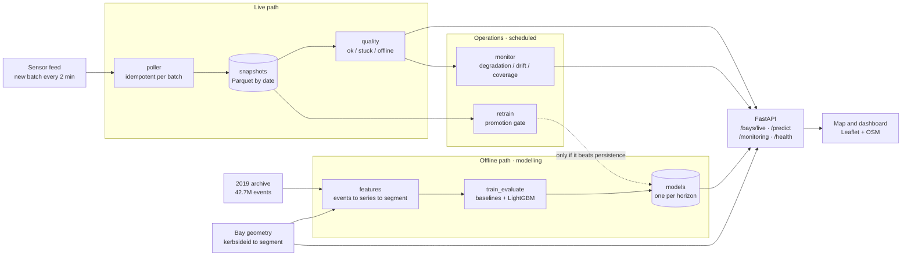

# parking-predict

Real-time on-street parking occupancy in Melbourne, and prediction of the
probability of finding a space in a zone **at the moment you arrive**.


<sub>Real screenshot. The stale-data warning appeared because the source feed
had gone 3.6 h without publishing a new batch — the *Outages* scenario the
source itself warns about. It is left as-is: that is the staleness detection
doing its job.</sub>

> Portfolio project. All eight phases of [PLAN.md](PLAN.md) are complete. The
> modelling results are on 2019 historical data; see
> [What this does not prove](#what-this-does-not-prove).

## Why predict, when real-time data already exists?

This is the question that justifies the project, and it deserves a measured
answer rather than an assertion.

When you drive 12 minutes to a destination, what matters is not how the street
looks **now** but how it will look **when you arrive**. The obvious — and
brutally hard — benchmark is answering with the current state: **persistence**.
All the work consists of checking whether that can be improved.

Short answer: **yes, and the margin grows with the horizon**.

| Horizon | Improvement over calibrated persistence |
|---|---|
| 5 min | 12.8% |
| 15 min | 14.9% |
| **30 min** | **15.0%** |

At 5 minutes persistence nearly suffices. At 30 — the real use case, the driver
already on the way — the prediction does change the answer.

But the strongest argument is not the Brier score, it is **calibration**. Raw
persistence answers *"0% probability"* in situations where **32%** of the time
there is space. A product built on it would send people searching further than
necessary one time in three.


## Architecture



Three design properties that come from findings, not preferences:

- **The poller is idempotent per feed batch, not per clock tick.** The feed
  publishes every 2 minutes and rewrites the whole dataset; naming each snapshot
  by `max(lastupdated)` means a retry or a restart rewrites the same cell
  instead of duplicating.
- **The API never queries the source**, it reads what the poller stored. An API
  outage does not interrupt capture, and a feed outage does not bring the API
  down — it keeps serving the last known state **while saying how old it is**.
- **Retraining has a gate.** A new model does not reach production unless it
  beats persistence.

## The four findings that shaped everything

### 1. `Present` means the bay is **occupied**

The field describes the car, not the bay. Inverting it breaks nothing: it
silently inverts the model's target.

### 2. Only 3557 of the 6324 bays give a usable reading

The feed fails in two distinct ways, and the second is invisible if you only
follow the source's advice (watch `lastupdated`):

| State | Bays | What is happening |
|---|---|---|
| `ok` | **3557** (56.2%) | reports and changes state |
| `stuck` | **1707** (27.0%) | reports, but the sensor has been frozen for a **median of 150 days** |
| `offline` | 1060 (16.8%) | absent from the feed's current batch |

**The most numerous failure is the invisible one.** And the failures are
relay-level, not sensor-level: 81 of 368 zones fail **as a block**. That is why
"no data" is a first-class state on the map rather than a hole.

### 3. The archive does not join to the real-time feed at bay level

All 238 datasets in the catalogue were swept: no dataset contains both
`kerbsideid` and `bayid`/`deviceid`, and the archive has no coordinates. The
apparent 7.4% overlap is arithmetic coincidence — a real join scores 95.5%.

What **does** work is the **street segment**, joining on the street name and its
two bounding streets: it covers **88% of the events**. Hence the project's
spatial unit is the segment rather than an H3 cell.

### 4. The model is, in essence, "a better-measured persistence"

The least impressive result and the most honest one. **90% of the gain** comes
from two features: the current state (44.2%) and its mean over the last 15
minutes (46.1%).

**Neighbouring zones contribute 0.6%** and the **calendar 1.6%**, where the plan
proposed them as relevant features. The daily cycle is very strong, but the
model does not need it: it is already implicit in the current state, which *is*
the result of the cycle.

## Where the model does **not** improve

The global mean is dominated by empty segments, where anyone gets it right.
Broken down by how full the zone is (15-minute horizon):

| Free bays now | n | Base rate | Improvement over the best persistence |
|---|---|---|---|
| **0 (full)** | 276,608 | **31.9%** | 12.1% |
| 1 | 446,600 | 86.0% | **20.7%** |
| 2 | 520,227 | 96.5% | 5.9% |
| 3-5 | 1,278,852 | 99.5% | 4.5% |
| 6+ | 2,492,945 | 100.0% | **irrelevant** |

- **In "6+ free" the skill looks like 69% and means nothing**: the base rate is
  99.99% and the absolute Brier is 0.0001. It is the kind of figure that looks
  great in a table and is noise.
- **At 5 minutes calibrated persistence already does 87% of the work.** A
  product that only showed the current state properly expressed as a probability
  would be nearly as good at that horizon.
- **The historical mean — pure routine — is the worst of the four models**
  (Brier 0.047 against 0.025), and at 30 minutes it is still worse than raw
  persistence. Knowing that "this street usually has space on Tuesdays at 11" is
  useless when the street is full right now.


## What this does not prove

1. **The modelling results are on 2019 data.** The published archive ends in May
   2020 and the sensor fleet was renewed (the numbering changed from `DeviceId`
   to `kerbsideid`). Training production on that data is not defensible.
2. **The model serving `/predict` is trained on 2019 and applied to today's
   data.** It is a **demonstration of the full flow**, not a reliable service.
   The warning travels inside every API response.
   Nuance measured in phase 7: that model **still beats persistence** on 2026
   data (+1.3% at 5 min, +20.3% at 30), better than I expected, although at the
   short horizon the skill fell from 12.8% to 1.3%.
3. **Retraining has never promoted anything**, because not enough data has been
   accumulated. The path is exercised (trains, evaluates, decides), but the
   promotion branch is only covered by tests.
4. **Drift detection is not interpretable yet.** The PSI compares ~6 night-time
   hours against a full month, so it mixes "the city has changed" with "it is
   night-time now". It demonstrates the pipeline works; it does not measure
   drift.
5. **No hyperparameter search.** The 15% improvement is a reasonable **floor**,
   not a ceiling.
6. **`total_bays` is the observed inventory, not the real one.** A bay with no
   events at all is invisible and indistinguishable from a dead sensor.
7. **Docker is not verified.** There is no Docker on the development machine, so
   `Dockerfile` and `docker-compose.yml` are written and validated as far as
   possible without it (the YAML parses, the commands are correct, everything
   has been run locally), but **the build has never been executed**.

## How this would apply to another city without sensors

The honest answer comes from the project's own data, and it is not comfortable.

**90% of the model's signal is the segment's current occupancy.** A city with
no way to observe occupancy in real time cannot use any of this: it would be
left with the historical mean, which was **the worst of the four models** and at
30 minutes does not even beat persistence.

Put differently: **what transfers is not the model, it is everything else**.

**What carries over as-is:**

- The **street-segment spatial unit** and the adjacency graph derived from
  street names — it needs no coordinates and no special gazetteer.
- The whole **data quality framework**: telling "not reporting" apart from
  "reporting but frozen" applies to any field sensor.
- The **evaluation**: persistence as a mandatory benchmark, Brier and
  calibration instead of accuracy, breakdown by occupancy level.
- The retraining **promotion gate**.

**What has to be replaced is the occupancy source.** In order of similarity:

| Source | What it gives | Problem |
|---|---|---|
| Meter / payment-app transactions | Occupancy of paid bays, near real time | Paid bays only; paying != being there, and there is evasion |
| Computer vision on traffic cameras | Occupancy per segment | Cost, partial coverage, privacy |
| Fleet or navigation data | Turnover and search time | Not occupancy, a biased proxy |
| Periodic manual counts | Calibration of a demand model | Useless for real time |

With payment transactions, the most common source, the pipeline would work
almost unchanged: they produce arrival/departure intervals, **exactly the same
shape as the 2019 archive** that `features/occupancy.py` already processes.

**The uncomfortable conclusion:** a city with neither sensors nor digital
payments does not need this project, it needs a data source first. This is a
tool for exploiting a signal that already exists, not for creating one.

## Getting started

Requirements: Python 3.12 and [`uv`](https://docs.astral.sh/uv/).

```bash
uv sync --all-groups --extra ml
cp .env.example .env
uv run pre-commit install
```

Checks:

```bash
uv run ruff check . && uv run ruff format --check . && uv run pytest
```

### Usage

```bash
# Real-time capture (every 2 min, the feed's native cadence)
uv run python -m parking.ingest.poller
uv run python -m parking.ingest.poller --once   # a single snapshot

# Map + API at http://localhost:8000
uv run python -m uvicorn --factory parking.api.app:create_app --port 8000

# Modelling, from the 2019 archive
uv run python scripts/build_dataset.py --months 2019-01:2019-12
uv run python scripts/train_evaluate.py
uv run python scripts/plot_results.py

# Reference geometry, which /predict needs
uv run python scripts/fetch_reference.py

# Operations
uv run python scripts/monitor.py
uv run python scripts/retrain.py --horizon 15

# Reproducible reports
uv run python scripts/crosswalk_report.py
uv run python scripts/quality_report.py
```

With Docker (**unverified**, see limitations):

```bash
docker compose up --build       # poller + operations + api -> http://localhost:8000
```

### API

| Endpoint | What it is for |
|---|---|
| `GET /bays/live` | State of every bay with its reliability flag |
| `GET /predict?lat=&lon=&eta_minutes=` | Probability of finding a space on arrival, per zone |
| `GET /zones/coverage` | Sensor coverage per zone |
| `GET /monitoring` | Latest operations report |
| `GET /health` | `ok`, `stale` or `no_data`, with the latest batch's age |
| `GET /docs` | Interactive OpenAPI |

`/predict` returns **several zones rather than the best one**, ordered by
distance: pointing at a single spot would send everyone who asks to the same
place.

## Documentation

Each phase left a report with its measurements and its limits:

| Document | Contents |
|---|---|
| [`data_schema.md`](docs/data_schema.md) | The real API schema, verified field by field |
| [`id_crosswalk.md`](docs/id_crosswalk.md) | Why the archive does not join to the real-time feed, and what does work |
| [`data_quality.md`](docs/data_quality.md) | The two sensor failure modes |
| [`dataset.md`](docs/dataset.md) | The prediction problem and how the dataset is built |
| [`results.md`](docs/results.md) | Comparison against the baselines, calibration, and where the model does help |
| [`operations.md`](docs/operations.md) | Retraining with a promotion gate, and monitoring |

## Layout

```
src/parking/
├── ingest/      # real-time polling, archive download, identifier crosswalk
├── quality/     # offline sensors, stuck sensors and network gaps
├── features/    # segments, occupancy, dataset and live features
├── models/      # baselines, LightGBM, evaluation and registry
├── monitoring/  # drift, backtest and coverage over time
├── api/         # FastAPI and the prediction service
└── config.py
web/             # map and operations dashboard
scripts/         # jobs and reproducible reports
data/            # raw/ interim/ processed/ reference/ — not versioned
```

**Stack:** Python 3.12 · polars · LightGBM · FastAPI · Leaflet · uv · ruff · pytest.

### A note on the stack

The plan called for pandas and DuckDB. The development machine's **Application
Control** policy blocks the native extensions of `pandas`, `duckdb` and
`pyarrow.parquet`, so the project uses **polars**, whose Rust Parquet engine
does work. DuckDB stays as an optional extra (`uv sync --extra sql`) for the
Linux container.

## Data attribution

This project uses data from
**[City of Melbourne Open Data](https://data.melbourne.vic.gov.au/)**, licensed
[CC BY 4.0](https://creativecommons.org/licenses/by/4.0/):

- `on-street-parking-bay-sensors` — real-time sensor state
- `on-street-car-parking-sensor-data-2019` — historical event archive
- `on-street-parking-bays` — bay geometry and inventory
- `on-street-car-park-bay-restrictions` — per-bay restrictions

The data is used without modifying its original content; any transformation in
this repository is the author's responsibility and not City of Melbourne's.
**This project is not affiliated with City of Melbourne.**

The base map is © [OpenStreetMap](https://www.openstreetmap.org/copyright) and
its contributors.

## Licence

Code: MIT (see [LICENSE](LICENSE)). The data keeps its original licence.
