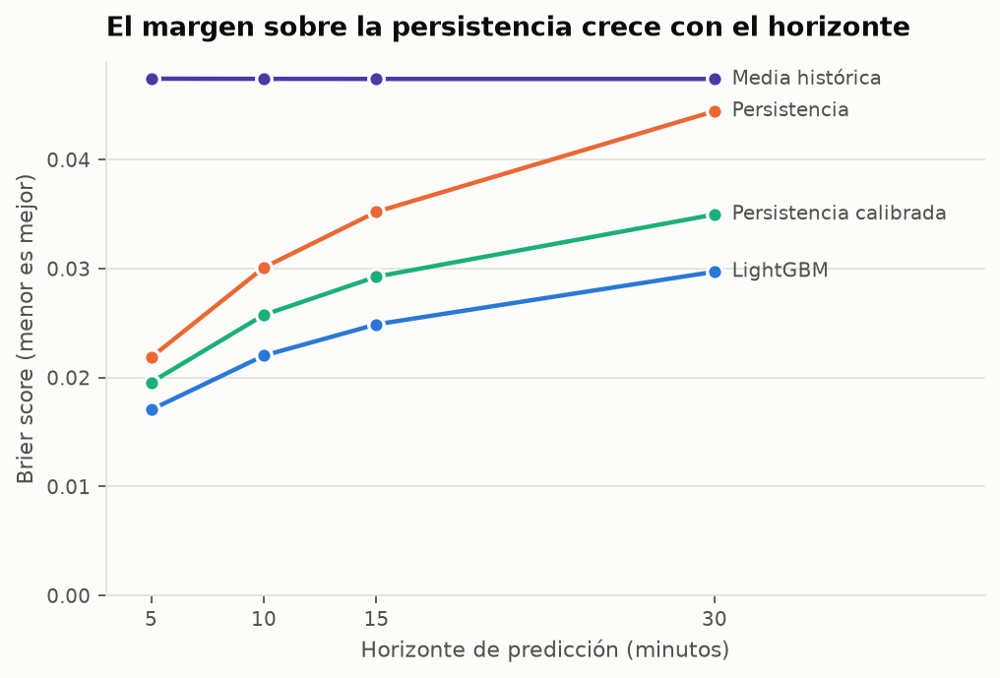
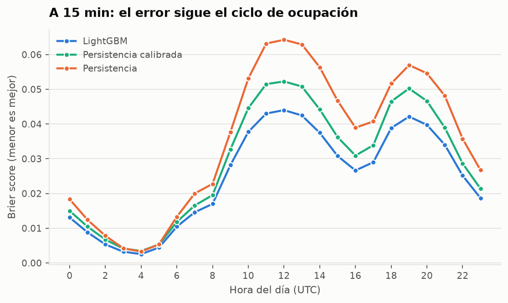

# Resultados

Informe de la Fase 5. Reproducible con:

```bash
uv run python scripts/train_evaluate.py
uv run python scripts/plot_results.py
```

## Resumen

**El modelo bate a la persistencia en los cuatro horizontes**, y la ventaja
crece al alejarse el horizonte: de un 12,8 % de mejora a 5 minutos hasta un
15,0 % a 30, frente a la persistencia calibrada.

Pero el titular honesto es más matizado, y está en la §5: **casi toda la
ganancia viene de suavizar el estado actual, no de aprender patrones**. Las
features de calendario y de zonas vecinas, que eran la apuesta del plan,
aportan menos del 2 % de la señal.

## Montaje experimental

| | |
|---|---|
| Entrenamiento | 2019-01 … 2019-09, submuestreado 1 de cada 4 instantes → **5 399 784 filas** |
| Validación | 2019-10 (parada temprana de LightGBM) → 627 192 filas |
| **Test** | **2019-11 … 2019-12 completo, sin submuestrear → 5 015 232 filas** |
| Tasa base en test | 94,49 % positivos |

Split **temporal**, nunca aleatorio. El test son los dos últimos meses del año,
posteriores a todo lo demás.

El entrenamiento se submuestrea en el tiempo (una fila de cada 4, es decir cada
20 min) para que quepa en memoria. El submuestreo es **por posición dentro de
cada tramo** y no aleatorio, para no romper la estructura temporal. El test no
se submuestrea: las métricas se miden sobre todo lo que hay.

### Los cuatro modelos

| Modelo | Qué usa |
|---|---|
| `persistence` | El estado actual, tal cual. Responde 0 o 1. Es la referencia del plan. |
| `calibrated_persistence` | El estado actual, pero expresado como la probabilidad empírica de que ese estado dure. **La referencia justa.** |
| `historical_mean` | Media por tramo, día de la semana y franja horaria. Ignora el estado actual. |
| `lightgbm` | Las 32 features. Un modelo por horizonte. |

La persistencia calibrada existe porque la cruda está en desventaja artificial:
al contestar 0 o 1, el log loss la castiga por el recorte y no por su contenido.
La calibrada tiene **exactamente la misma información** —el estado actual, nada
más— y no sufre ese castigo. Es la que hay que batir de verdad.

## 1. Comparativa por horizonte



**Brier score** (menor es mejor):

| Horizonte | LightGBM | Persistencia calibrada | Persistencia | Media histórica |
|---|---|---|---|---|
| 5 min | **0,01706** | 0,01957 | 0,02186 | 0,04743 |
| 10 min | **0,02202** | 0,02575 | 0,03010 | 0,04742 |
| 15 min | **0,02489** | 0,02927 | 0,03522 | 0,04741 |
| 30 min | **0,02972** | 0,03497 | 0,04445 | 0,04741 |

**Log loss** (menor es mejor):

| Horizonte | LightGBM | Persistencia calibrada | Persistencia | Media histórica |
|---|---|---|---|---|
| 5 min | **0,0597** | 0,0871 | 0,3020 | 0,1910 |
| 10 min | **0,0754** | 0,1096 | 0,4158 | 0,1913 |
| 15 min | **0,0847** | 0,1221 | 0,4865 | 0,1905 |
| 30 min | **0,1010** | 0,1425 | 0,6141 | 0,1901 |

**Mejora del LightGBM** (Brier skill score):

| Horizonte | vs persistencia calibrada | vs persistencia cruda |
|---|---|---|
| 5 min | 12,8 % | 22,0 % |
| 10 min | 14,5 % | 26,8 % |
| 15 min | 14,9 % | 29,3 % |
| 30 min | **15,0 %** | **33,1 %** |

Tres lecturas:

- **La ventaja crece con el horizonte.** Es lo esperado y lo que justifica el
  proyecto: cuanto más lejos está el momento de llegada, menos sirve el estado
  actual. A 5 minutos la persistencia casi basta; a 30 ya no.
- **La media histórica es plana** (≈0,0474 en los cuatro horizontes) porque
  ignora el estado actual, así que el horizonte le da igual. A 30 minutos sigue
  siendo **peor que la persistencia cruda** (0,0474 vs 0,0445): la rutina por sí
  sola no supera a mirar cómo está la calle ahora, ni siquiera a media hora
  vista.
- **La persistencia cruda sale muy mal en log loss** (0,30 → 0,61) frente a la
  calibrada (0,087 → 0,14). No es que prediga peor: es que decir "0 %" cuando
  hay un 32 % de probabilidad es un error grave para un producto que muestra
  probabilidades.

## 2. Calibración


Es el entregable real: la pantalla muestra una probabilidad, así que lo que
importa no es solo ordenar bien, sino que el número signifique lo que dice.

Error de calibración esperado a 15 min:

| Modelo | ECE |
|---|---|
| LightGBM | **0,0015** |
| Persistencia calibrada | 0,0014 |
| Persistencia cruda | 0,0352 |

LightGBM está bien calibrado en todo el rango (desviación máxima de 0,017 en los
tramos bajos) y además **cubre todo el rango**: emite probabilidades en los diez
deciles. Las dos persistencias solo emiten dos valores distintos; por eso en el
gráfico aparecen como puntos sueltos y no como curva, porque unirlos sugeriría
unos valores intermedios que nunca producen.

El punto naranja en `(0,0 ; 0,32)` es el argumento entero contra la persistencia
cruda como producto: **dice "0 % de probabilidad" en situaciones donde el 32 %
de las veces sí hay sitio.** A un conductor le estaría diciendo que no vaya a
una calle donde una de cada tres veces encontraría aparcamiento.

## 3. Desglose por nivel de ocupación


Es el desglose que pide el plan, y el que de verdad importa: la media global
está dominada por los tramos vacíos, donde todo el mundo acierta.

A 15 minutos:

| Plazas libres ahora | n | Tasa base | Persistencia | Calibrada | LightGBM | Mejora |
|---|---|---|---|---|---|---|
| **0 (lleno)** | 276 608 | **31,9 %** | 0,3193 | 0,2174 | **0,1910** | 12,1 % |
| 1 | 446 600 | 86,0 % | 0,1404 | 0,1358 | **0,1077** | 20,7 % |
| 2 | 520 227 | 96,5 % | 0,0352 | 0,0343 | **0,0323** | 5,9 % |
| 3-5 | 1 278 852 | 99,5 % | 0,0055 | 0,0056 | **0,0053** | 4,5 % |
| 6+ | 2 492 945 | 100,0 % | 0,0001 | 0,0004 | 0,0001 | — |

Lo importante:

- **Cuando el tramo está lleno, solo el 31,9 % de las veces habrá sitio 15
  minutos después.** Ahí vive el problema difícil, y ahí LightGBM mejora un
  12,1 % sobre la mejor persistencia. Es un caso real y frecuente: 276 608
  observaciones, el 5,5 % del test.
- **El mejor caso es "1 plaza libre"**, con un 20,7 % de mejora. Tiene sentido:
  es la situación más inestable: basta que llegue un coche para que la respuesta
  cambie, y ahí la tendencia reciente y el ritmo de rotación sí informan.
- **En "6+ libres" la mejora no significa nada.** La tasa base es del 99,99 % y
  el Brier absoluto es 0,0001; cualquier diferencia relativa ahí es ruido sobre
  un problema que no existe. Lo menciono porque un skill score del 69 % en esa
  fila quedaría muy bien en una tabla y no querría decir nada.
- **La media histórica se hunde en el caso lleno** (Brier 0,507, peor que no
  predecir nada). Saber que "los martes a las 11 esta calle suele tener sitio"
  es inútil cuando la calle está llena ahora mismo.

## 4. Desglose por hora



El error sigue el ciclo de ocupación: mínimo de madrugada (todo vacío, todo
fácil) y máximo en los dos picos, mediodía y tarde-noche. La mejora del modelo
es **positiva en las 24 horas**, entre el 11,6 % y el 26,1 %.

En términos absolutos la ganancia es mayor en las horas punta, que es donde hay
algo que ganar: a las 12 UTC el Brier pasa de 0,0523 a 0,0440.

## 5. Qué aprendió el modelo (y qué no)

Importancia por ganancia a 15 minutos:

| Feature | Ganancia |
|---|---|
| `free_bays_mean15` | **46,1 %** |
| `free_bays` | **44,2 %** |
| `free_bays_mean30` | 3,2 % |
| `free_bays_mean60` | 1,5 % |
| `hour` | 1,2 % |
| `occupancy_rate` | 0,7 % |
| `neighbour_occupancy_rate` | 0,3 % |
| `neighbour_free_bays` | 0,3 % |
| resto (24 features) | < 2,5 % |

**El 90 % de la señal son dos features: el estado actual y su media de los
últimos 15 minutos.** Esto hay que decirlo tal cual porque contradice en parte
la hipótesis del plan:

- **Las zonas vecinas aportan un 0,6 %.** El plan las proponía como feature
  relevante y los datos dicen que apenas lo son. Posible explicación: la
  adyacencia derivada de nombres de calle es tosca, y la ocupación de un tramo
  ya resume bastante bien la presión de su entorno.
- **El calendario aporta ~1,6 %** (`hour` + `day_of_week` + festivos). El ciclo
  diario es fortísimo —se ve en el §4— pero el modelo no lo necesita: ya está
  implícito en el estado actual, que *es* el resultado del ciclo.
- **Lo que de verdad añade valor sobre la persistencia es la media móvil de 15
  minutos**, es decir, suavizar el ruido de la medición instantánea y captar la
  tendencia. Una interpretación justa del resultado es que el modelo es, en
  esencia, "una persistencia mejor medida".

Es un resultado menos lucido que "el ML descubre patrones ocultos", pero es el
que hay.

## 6. Limitaciones

Lo que estos números **no** demuestran:

1. **Son resultados sobre 2019.** El dataset es histórico y no sirve para
   producción (razones en [`id_crosswalk.md`](id_crosswalk.md) §5: deriva
   temporal y renovación del parque de sensores). Que LightGBM mejore un 15 %
   en 2019 no garantiza que lo haga hoy. Habrá que repetir esta evaluación con
   los datos que acumule el poller.
2. **No hay búsqueda de hiperparámetros.** Los parámetros son conservadores y
   fijos. Con un baseline tan fuerte, lo que decide el resultado es si las
   features aportan algo, y ajustar el tercer decimal del `learning_rate` antes
   de saberlo sería optimizar ruido. La mejora del 15 % es por tanto un **suelo**
   razonable, no un techo.
3. **El entrenamiento está submuestreado 1 de cada 4.** Con los datos completos
   el modelo podría mejorar algo; no se ha medido.
4. **`total_bays` es el inventario observado, no el real.** Si un sensor estuvo
   muerto todo un mes, su plaza no existe para el modelo, y el objetivo "hay al
   menos una libre" se evalúa sobre un denominador incompleto.
5. **Las fechas van sin zona horaria**, así que los dos días de cambio horario
   de 2019 están corruptos. A escala de dos meses de test es ruido.
6. **No se ha evaluado la alternativa de predecir el recuento** y derivar la
   probabilidad, aunque el dataset la soporta (`free_bays_h*`). El plan la pedía
   como alternativa a evaluar y queda pendiente.

## 7. Conclusión para el producto

**Sí vale la pena predecir**, pero con dos matices que conviene no esconder:

- A **5 minutos**, la persistencia calibrada ya hace el 87 % del trabajo. Si el
  producto solo mostrara el estado actual bien expresado como probabilidad, sería
  casi tan bueno.
- A **30 minutos** —que es el caso de uso real, el conductor que va de camino—
  la mejora es del 15 % sobre la mejor persistencia y del 33 % sobre la cruda,
  y en las zonas llenas llega al 12 %. Ahí la predicción sí cambia la respuesta.

Y el argumento más fuerte no es el Brier sino la **calibración**: la persistencia
cruda afirma "0 %" en situaciones con un 32 % de probabilidad real. Un producto
construido sobre ella mandaría a la gente a buscar más lejos de lo necesario una
de cada tres veces.

## Atribución

Datos de [City of Melbourne Open Data](https://data.melbourne.vic.gov.au/),
licencia [CC BY 4.0](https://creativecommons.org/licenses/by/4.0/).
